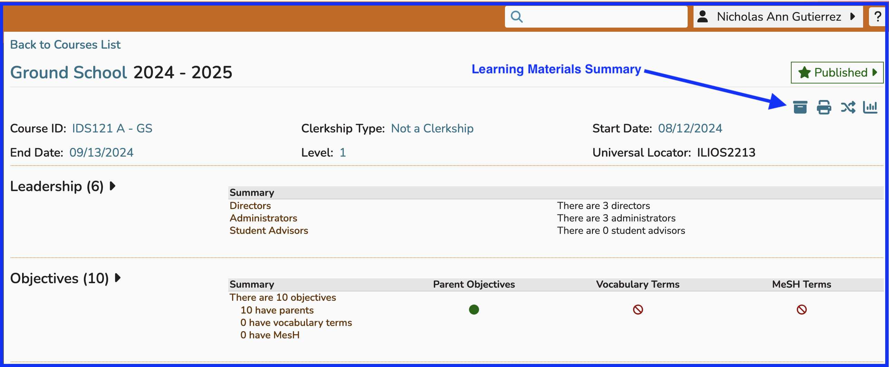
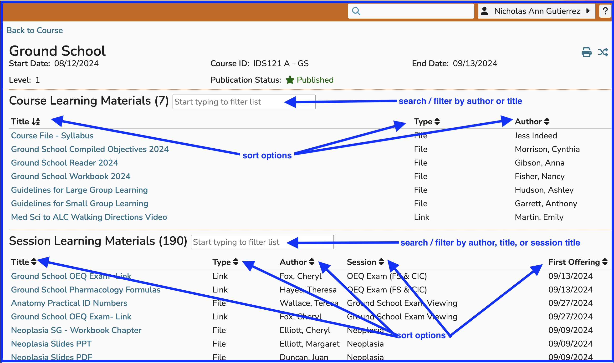
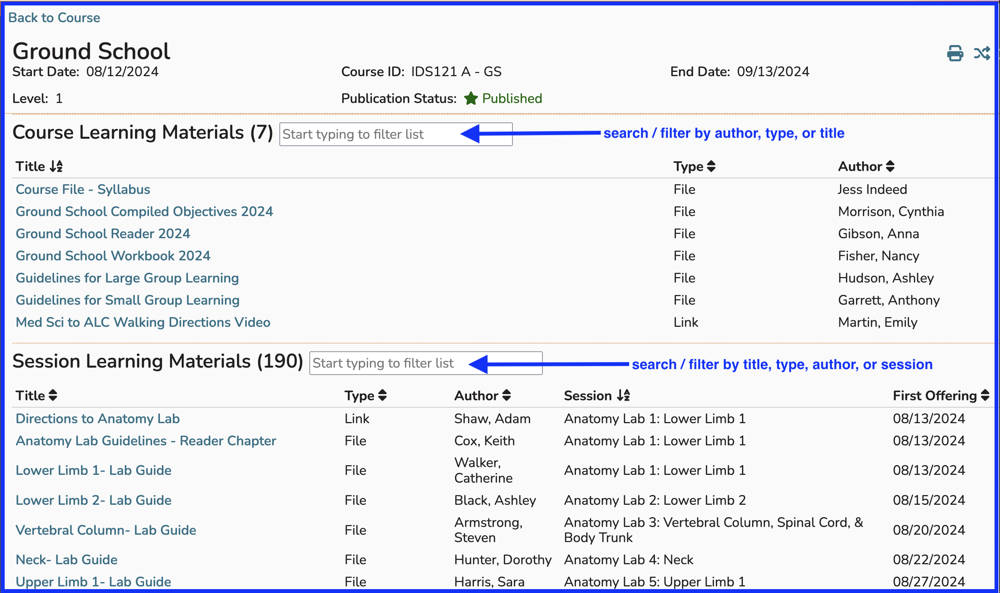
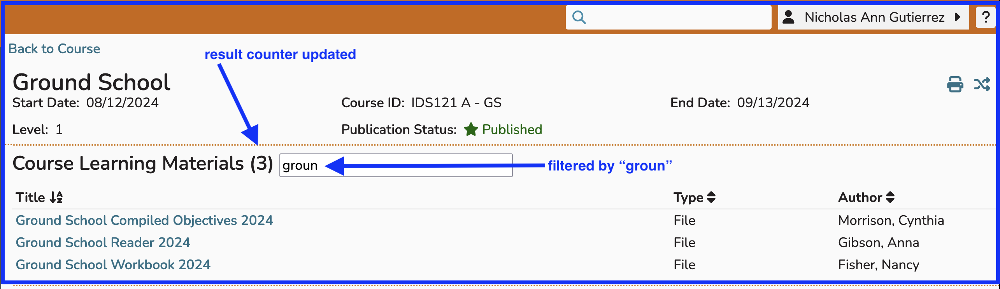
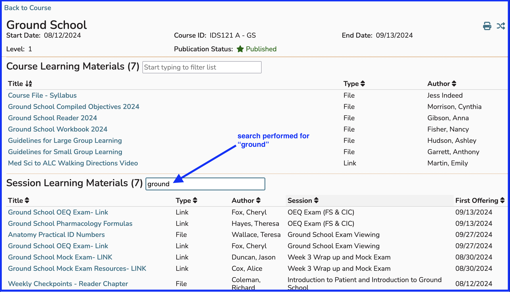

# Learning Materials Summary

A useful feature of Ilios is the Learning Materials Summary, which for the Course selected, contains links to all of the Learning Materials associated with that Course as well as all of those for Sessions in that Course. It is a one stop place to obtain all of the Learning Materials for the selcted Course.

To go to the Learning Materials Summary, pull up a Course and click the correct icon as shown below.

## Search and Filter

The available searching and filtering options are shown below.

## Sort Order Options

### Course Materials

At the course level, the screen can be sorted by learning material title, type, or author - ascending (A-Z) or descending (Z-A).

### Session Materials

At the sessions level, the learning materals can be sorted by title, type, author, session title - ascending (A-Z) or descending (Z-A), or by first offering (by most recent or oldest).

## Search Options

Searches within the course learning material summary can be performed at the course level and / or the session level. Examples of both are shown below.

### Course Materials Search

A **Course** level search is performed below with the matches circled. There are three course learning materials with a title containing "groun". This filtering operation shows the records that match this entry.

### Session Materials Search

A **Session** level search is shown below.

In the example shown below, a Session level search is performed for "ground" (case-insensitive) and sorting was performed on the session learning material title in ascending alphabetic order.

The search results for "ground" are displayed. The counter is updated to reflect the count of the records returned by the search.

Any of the learning material objects can be accessed by clicking on the link located under the "Title" header.

