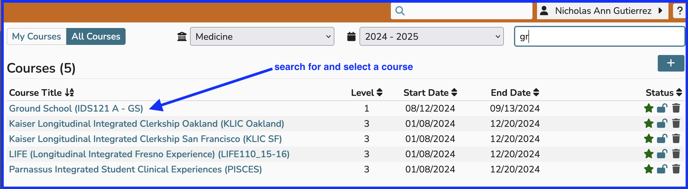
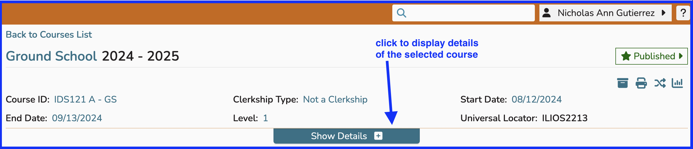
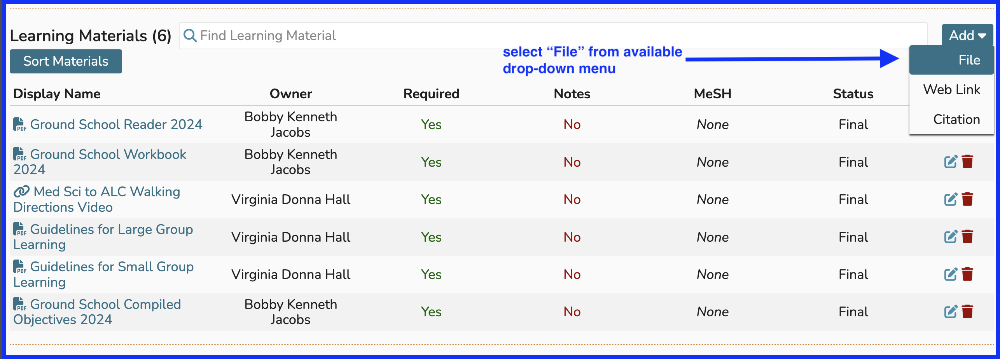
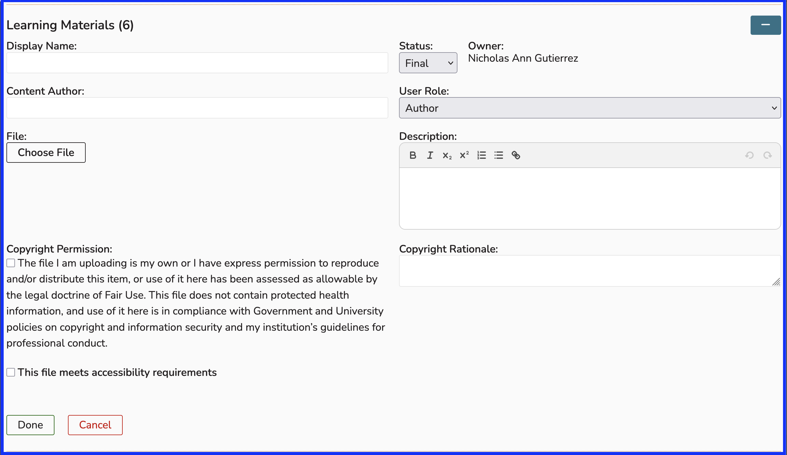
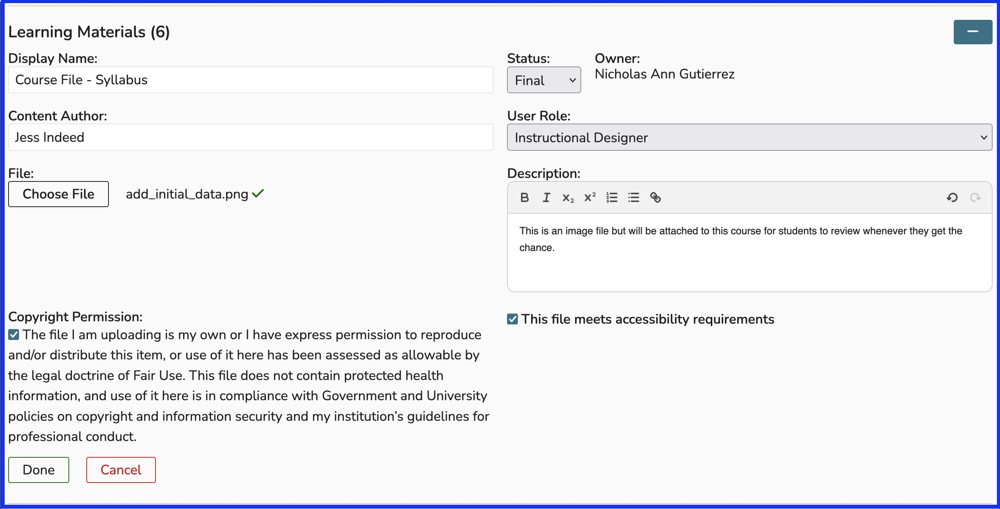
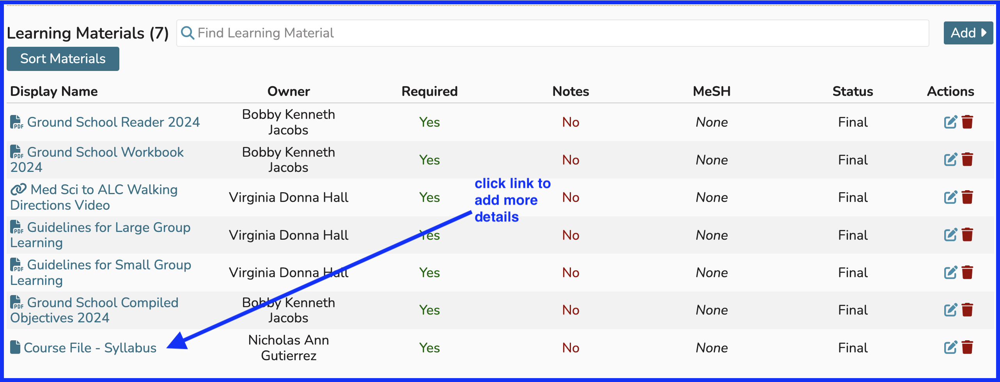
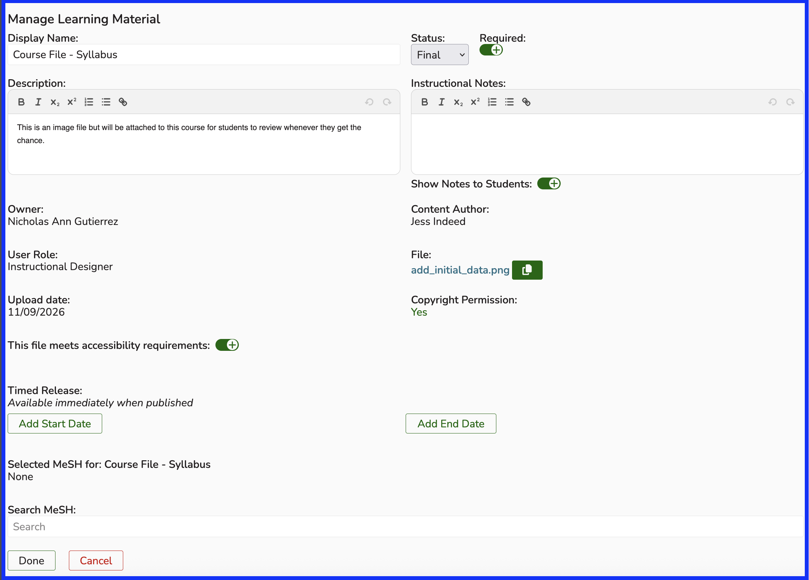

# Upload New Learning Material

If you are certain that a Learning Material object does not exist in the repository since the file or link is newly created or updated, Ilios allows simple and easy uploading of new Learning Material(s). 

## Select Course

## Show Course Details

By default a course is not initially displayed in the expanded view. Click "Show Details" to expand the course's details (Learning Materials is one of these details).

Scroll down to the Learning Materials section of the page. Click the "Add" drop-down button to select which type of Learning Material will be attached to the Course.

After selecting the Learning Material type, when "File" is selected, the screen appears as follows allowing the user to enter and or select some initial data attributes about the file being selected.

## Enter Metadata

After the fields have all been filled in and the file has been selected from your computer, click the "Done" button to process the save event to attach this learning material file to the course.

## Enter Additional Details

To enter additional details about the Learning Material object, select it from the list of existing Learning Materials that are attached to the Course.

The following fields can be modified after selecting the learning material to modify.

* Status - final means published in this context
* Required (toggle between Yes and No)
* Description
* Instructional Notes
* Show Notes to Students (toggle between Yes and No) - refers to instructional notes
* Meets Accessibility Requirements - (toggle between Yes and No) -- captioned "This file meets accessibility requirements." 
* Timed Release - Start Date and End Date - entered here referring to the usage of this learning material object
* MeSH terms - can be added or removed from course-level learning material objects here

**IMPORTANT:** All of the fields entered initially can no longer be modified. At as of this writing, it would be necessary to re-upload the file to change these attributes or upload an updated version of the file if it exists.

## Other Learning Material types

For associating a Web Link or Citation to a Course or Session, the process is similar but actually a bit more simple since Copyright Permission and Copyright Rationale do not apply in these cases.

### Associating MeSH Terms with a Learning Material Object

MeSH terms can be associated with Learning Material Objects. To do this ...

* Select an attached learning material from the list.
* Scroll to the bottom of the learning material detail.
* Enter search criteria to perform a search for MeSH and hit enter on the keyboard.
* Select one or more MeSH Terms from the result set by clicking on them with your mouse.
* When finished, click the green arrow Save button or the red Undo button if you change your mind about adding or removing MeSH term(s).

