# Publishing

Ilios has a built in publishing workflow for curricular material. The publishing workflow serves the purpose of allowing the review of data prior to release, and to provide for the option of release in both interim (“Not Published” or “Scheduled”) and final (“Published”) modes. This is made possible by providing a summary checklist to the user for review. The checklist takes one of three different forms, depending on the workflow chosen: **Course Level**, **Single Session**, or **All Sessions**.

There are two places in Ilios where the concept of **"Publishing"** applies ...

* [**Courses**](https://iliosproject.gitbook.io/ilios-user-guide/courses-and-sessions/courses)
* [**Sessions**](https://iliosproject.gitbook.io/ilios-user-guide/courses-and-sessions/sessions)

## Workflow Options 

The action of publishing a number of sessions at once or single sessions after publishing the course itself among other options are explored below. 

### Course Level

If a course gets published as shown in the "Publish a Course" section below, all sessions that have been published will be pushed out to the student calendar and feed as soon as the course publication process is completed. This can be helpful if all sessions are ready. 

### Session Level 

Following the "Publish a Session" process detailed below, if a session gets published, the course must also be published for the offering or ILM to appear on student calendars. This can be helpful if you want to release the offerings one session at a time rather than in one big calendar push.

### All Sessions 

This process does require that the course publication process be handled separately; but it can be used to publish any and all sessions that have reached the minimum of required fields. You can exclude some sessions from being published. This process can be repeated in the future if more sessions become ready to publish (they have offerings and / or due date if ILM).

## Publish a Course

In the example below, all of the required fields have been entered and the Sessions have been entered and are ready to be published as well. Publishing a Course is in effect, finalizing it. If the Sessions for a Course are also published and there are Offerings or ILM's to display, these events will be displayed on a Student's calendar and will be included in the .ics Calendar Feed.

Both **Course** and **Session** must be published in order to have the attached Offerings displayed on Student Calendars.

**IMPORTANT TO NOTE:** **Instructors** and other Ilios users with advanced non-learner permissions such as Course or Session Directors and Administrators, will see all of their Offerings, even if the Course or Session has **NOT** been published; whereas **Students** will not. The "not published" icon will appear on the calendar and on event detail to assist with identifying sessions which have not been published.

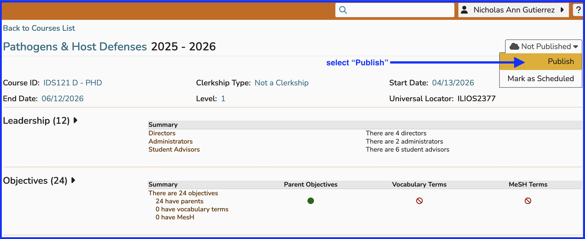

After performing the step indicated above, you will be routed to confirm the publication of the selected course. 

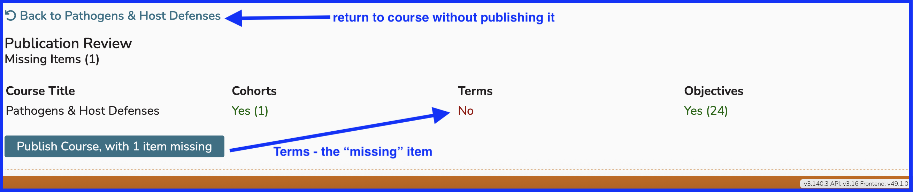

This occurs even if all requested data elements have been attached. In this case, the course in question did not have vocabulary terms attached. You will need to confirm that this is fine in order to publish the course. After doing so, the publication status drop-down now correctly reflects the updated course status as "Published".

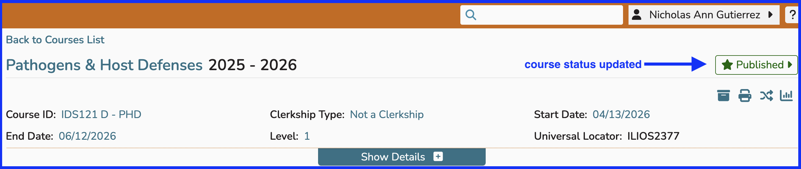

There are 2 different types of data attributes available for checking in the workflow: **required** fields, which must be present for publishing, and if unavailable will make the publish button in the checklist inactive; and **desired** fields, which may be overridden after review, or left as-is without override. If overridden, the course object publishes normally. Alternatively, the course object can be published as “TBD”, or “Scheduled” – which reserves space on the calendar for users to see, but does not provide details of the session. Re-publishing a course or session at any time will update the information contained in it to its most recent state. Courses and sessions are independent of one another in the workflow, and can be published individually. A course, as the parent container of its sessions, may also be published together with all of its associated sessions.

In the **Course Level Only** workflow, the top-level (“course-level”) attributes in a course are checked to verify required information. Course level attributes which are checked are:

### Required Fields

* Start Date (required)
* End Date (required)
* Associated Cohort (required)

### Optional Fields 

* Vocabulary Terms
* Objectives

The required fields for publishing a Course are indicated in the top section above. The others are desired fields and are listed here as optional. The absence of one or more of the required fields will disallow publishing or override. The absence of one or more of the desired fields will activate the display of a “Review X Items” value on the Publish drop-down menu. If you choose to review the missing items, the Publish option will be available on the review screen. You are required to review the items before publishing the Course or select "Publish As Is".

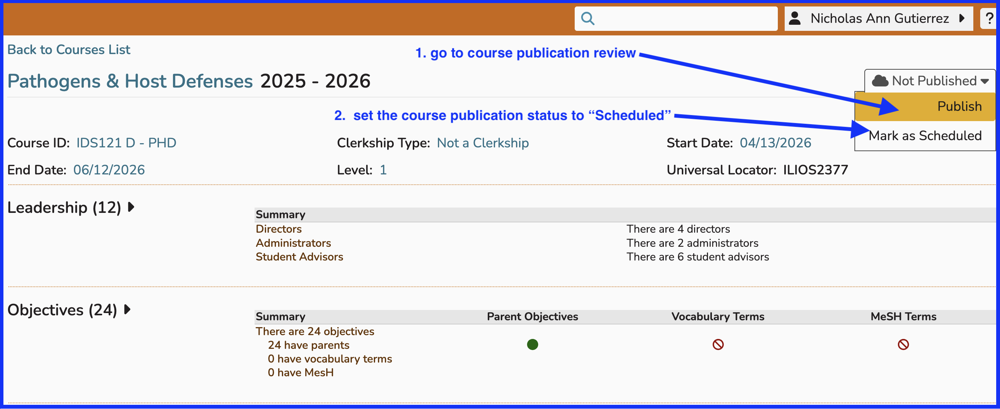

**Publication Options explained**

Using the screen shot above as a guide, here are the options described.

* (1) go to course publication review and decide to publish or not - review any possible missing data 

* (2) set the publication status of the course to "scheduled" - sets the course in a "to be determined" state - students will see "TBD" on calendar (if session is published or if session also has a status of "scheduled") with details to be revealed when the course itself gets published. This is only available on Calendar not Week at a Glance.

## Publish a Session

### Single Session

In the **Single Session Only** workflow, a single session is checked to verify data. Session level attributes checked are:

* **Title** (required)
* **Offering** (required for non-ILM) / Due Date (required if ILM is set to "true")
* **Vocabulary Terms** (desired but not required) - one or more
* **Objectives** (desired but not required) - one or more

The first two fields listed above are required to create a session. The others are desired fields. The absence of one or more of the required fields will disallow publishing. 

The publication menu displays **"Publish"** whether requested items are missing or not. You will always be routed to confirm the course publication either way. 

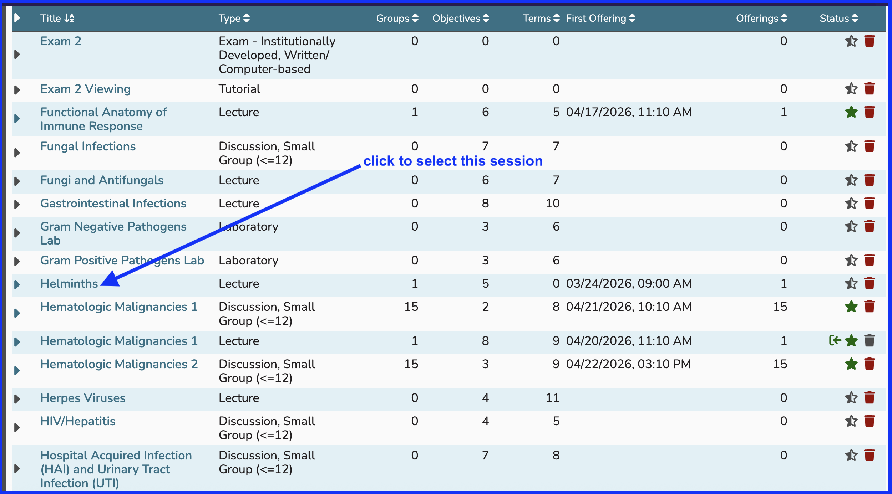

## Publication Workflow

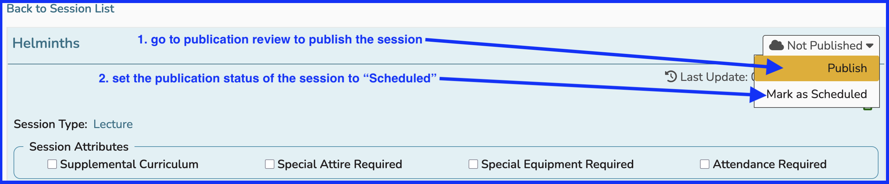

### Review Before Publication

Upon clicking Option #1 (**Publish** - see above), the screen will display what data from among the desired fields is missing, if any. In this case, no vocabulary terms have been associated with this session. You can ignore this and publish anyway or add one or more vocabulary terms.

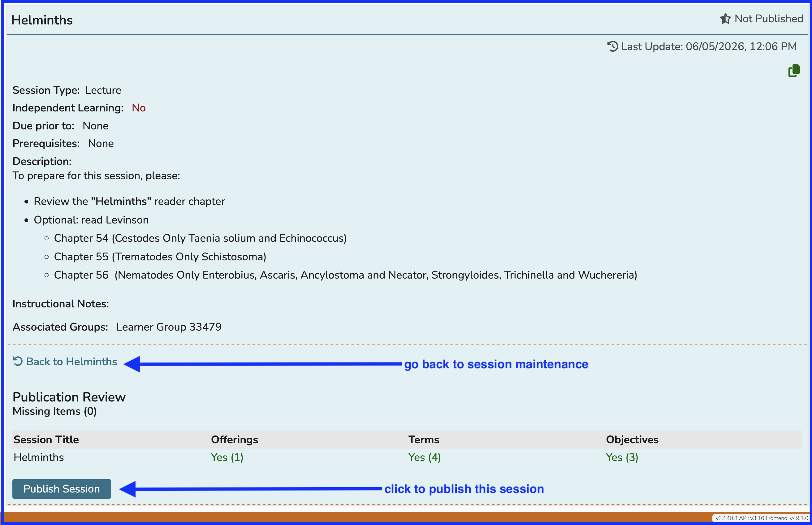

In the **Publish Full Course with All Sessions** workflow, a display of the course level info and every associated session is made available. The course level info and each session function independently as above, allowing override individually. If an associated session was previously in published state, it will still be displayed in the list and allow for republishing following the rules above. Any changes to a previously published session will overwrite its previous status. A course may be in Not Published state, yet have sessions which are Published or Scheduled. The Published/Scheduled sessions will not display on the public calendar until the parent course is in published or Scheduled state. Sessions in a "Not Published" state are never displayed on the school calendar ("Show All Events").

When a course is in Scheduled state and has sessions in Published and/or Scheduled state, those Published and Scheduled sessions will display as TBD until the course is published. A published course will display any Scheduled or Published sessions as their state indicates accordingly.

## Publication Review

This publication review process is available for use at the course level. The means to access this functionality is shown below. In this case, course details are hidden. The button is always available at the top of the session list.

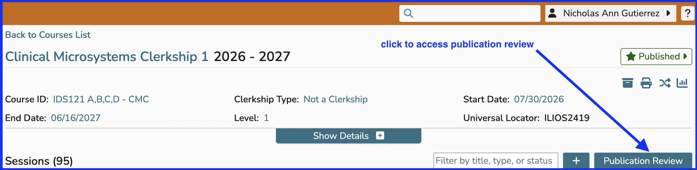

After clicking the "Publication Review" button, as shown above, there will be an opportunity to review all of the sessions before taking action on publication on any or all of the associated sessions. Some of the session may have been published already.

After clicking as shown above, the screen appears similar to the image in the screenshot below. Initially, "Unpublished Sessions" is expanded while the other two sections "Incomplete Sessions" and "Published Sessions" are contracted. Clicking the triangle arrows to the right of the captions will expand the selected section. In "Unpublished Sessions", clicking the buttons labeled "Publish All" or "Mark All as Scheduled" will apply that setting to the entire list of Sessions below in any given review section. They can be edited individually using the provided check boxes. "Leave as Unpublished" can be individually selected to omit the selected sessions from having any action taken.

It is important to note that the sessions in "Sessions Incomplete: cannot publish" can only be reviewed - a listing of missing required items (generally offerings) will be displayed advising why these sessions cannot be published at this time. Links are provided to modify any of these sessions. The "Published Sessions" section is also read-only with links provided for review.

The screen shot below shows the review screen for the publication review workflow. "Sessions Requiring Review" appears in expanded mode. The other two areas are in contracted mode but can be expanded using the provided arrow expanders. 

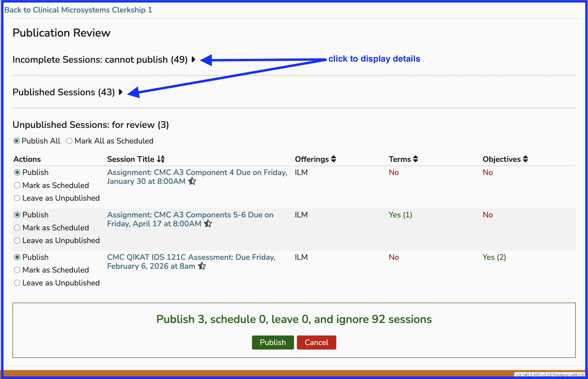

You may need to scroll to get to the "Publish" and "Cancel" buttons. In this case there is no need to scroll since there are only three sessions requiring review. Clicking "Publish" will perform the indicated action. A link to the [course objective visualization](https://iliosproject.gitbook.io/ilios-user-guide/courses-and-sessions/courses/visualizations#objectives) appears when one or more of the course objective(s) have not been mapped to their parent objectives - program year objectives. The link mentioned above appears in the same area as the action buttons and states simply "This course has unlinked objective(s)" along with an icon to follow the link mentioned above.

### Incomplete Sessions 

These are sessions that cannot be published. Generally, they lack offerings, which are required unless the session happens to be set up as an independent learning module ([ILM](https://iliosproject.gitbook.io/ilios-user-guide/courses-and-sessions/sessions/independent-learning-module-ilm)).

This is shown below. The default sort order is by session title (A-Z). The other columns can be used to specify sort order instead - ascending or descending.

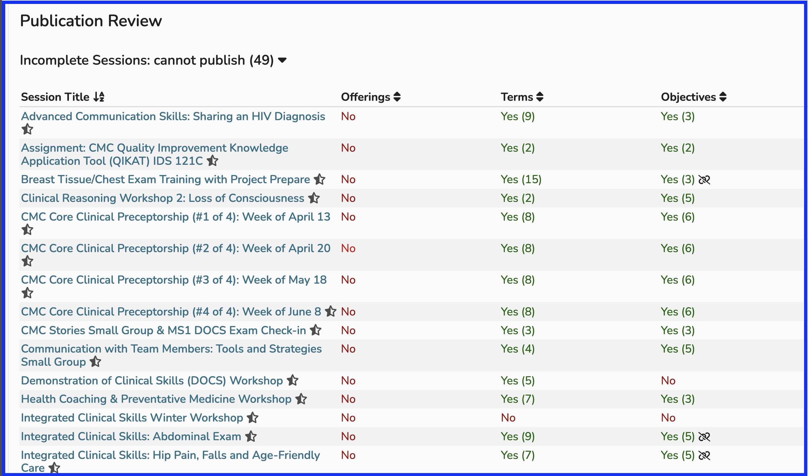

### Published Sessions 

This section appears initially in contracted mode. Expanding this section will provide a list of all session that have been published.

Expanding this section will review a handy list (with sticky column headers upon scroll down) to review all of the sessions that been published. No actions can be taken from here. This is just for informational review. 

This is shown below. ILM sessions do not require offerings. This is indicated in the list.

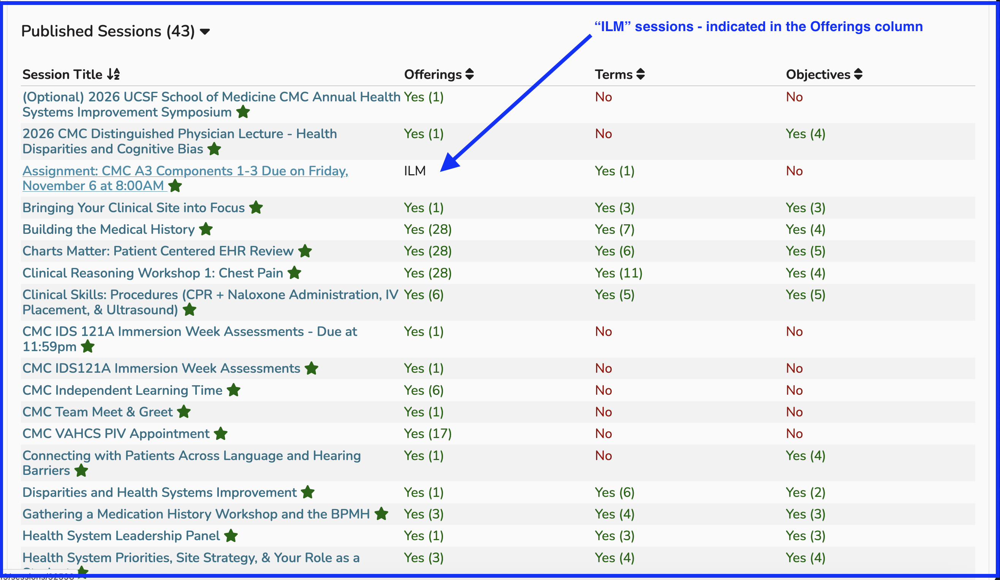

Maintenance to any of the sessions above can be performed by clicking on the linked session title. If Terms or Objectives are missing and you wish to add them, that can be done from here if it ends up being convenient for your workflow.

### Unpublished Sessions 

These sessions are "for review" meaning you can choose to publish them, set them to the status of "Scheduled", or leave them as they currently are - "Unpublished".

In the screen shot below, one session has been selected to be published, on session has been selected to be scheduled, and one will be left alone in an unpublished state. Notice the button caption and confirmation label have adjusted to demonstrate this reality.

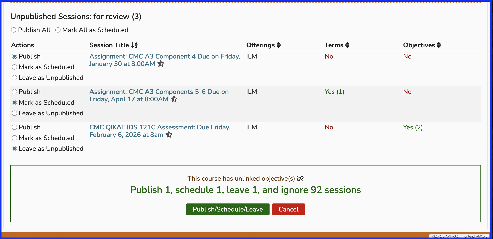

As shown above, a link is provided to route the user back to the course objectives listing when there are one or more course objectives which are not linked to parent (program year) objectives. There is no required action here. It's there to allow for review.

### Take Action - Publish or Cancel

If all sessions in a selected course have already been published, "Cancel" is the only option. If there is still action that can be taken, "Publish" is available. In this case, there are three sessions that have been selected for publication. The button caption will adjust if there are sessions selected to leave or schedule. 

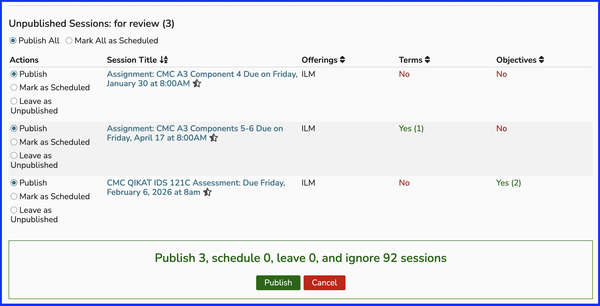

