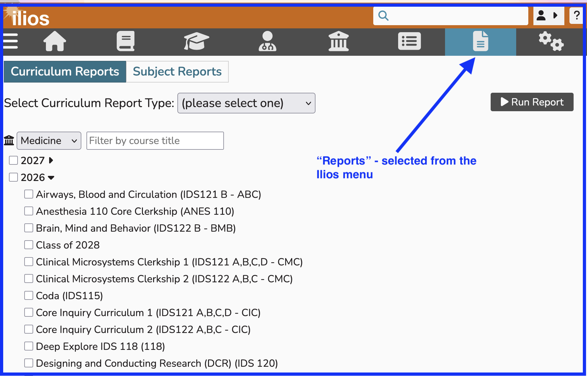

# Reports

Reports now live in their own distinct functional area rather than "My Reports" of yesteryear. This allows for better visibility of results as well as inclusion of data tables and legends.

## Starting Point 

Clicking on "Reports" from the Ilios menu takes the user to "Curriculum Reports" initially. This is the new reporting suite, including the ability to create and download reports for multiple courses as a set. This can be from with any given year or longitudinally across years. This provides real-time access to complex data. We will be continuing to add additional functionality to this area.

The other reporting option is "Subject Reports". These reports can be saved and accessed at any time. These reports are configured using the drop-down menus presented. 

